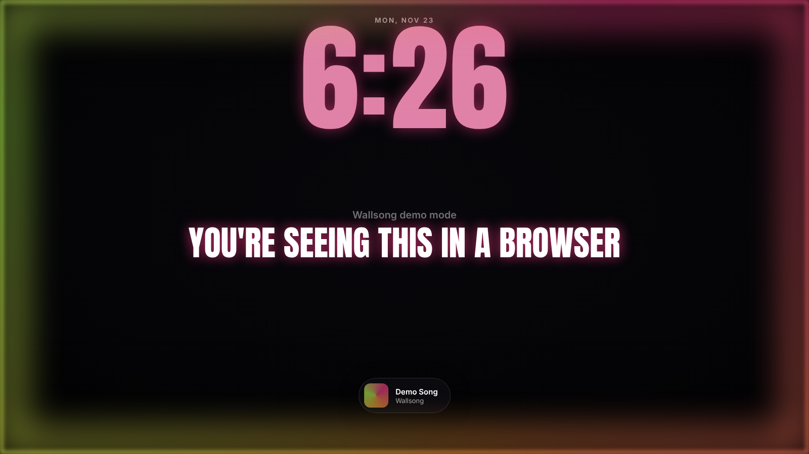

# Wallsong

Your desktop, on the beat. A music skin that lives behind your desktop icons on Windows: a giant clock, synced lyrics that rise line by line, and light around the screen in the album's colours, pulsing with the bass.

This is the **Week 1 test build**. It exists to prove the three risky native parts work together on your PC before anything else gets built.



## What works in this build

| Part | How | File |
| --- | --- | --- |
| What's playing (Spotify app, YouTube Music in Chrome/Edge, most players) | Windows media session (SMTC), polled every 250 ms | `src-tauri/src/media.rs` |
| Synced lyrics | LRCLIB (free, no key) | `src-tauri/src/lyrics.rs`, `src/lib/lrc.ts` |
| Beat-reactive edge glow | WASAPI loopback of your speakers (never the mic) | `src-tauri/src/audio.rs`, `src/components/EdgeGlow.tsx` |
| Sitting behind the desktop icons | WorkerW parenting, with the Windows 11 24H2 layout handled | `src-tauri/src/desktop.rs` |
| Album colours | Dominant colours picked from the artwork | `src/lib/palette.ts` |
| Quit | Tray icon by the clock: right-click > Quit Wallsong | `src-tauri/src/lib.rs` |

Not in this build (next weeks): music-video wallpaper (blurred album art stands in for it), clickable player and search, lyric styles, settings.

## Set up on Windows (once)

1. **Node.js 20 or newer**: https://nodejs.org
2. **Rust**: https://rustup.rs, then `rustup default stable`
3. **Microsoft C++ Build Tools** with the "Desktop development with C++" workload: https://visualstudio.microsoft.com/visual-cpp-build-tools/
4. **WebView2**: already on Windows 11; on Windows 10 get the Evergreen runtime from Microsoft if it's missing.

## Run it

```powershell
cd wallsong
npm install
npm run tauri dev
```

The first run compiles the Rust side and takes a few minutes. Then:

1. Play a song in the Spotify app, or in YouTube Music in Chrome or Edge.
2. Wallsong appears as your wallpaper, behind your icons.
3. Quit from the tray icon by the clock, or press Ctrl+C in the terminal.

To work on the look without Windows APIs, run `npm run dev` and open http://localhost:1420 in a browser. It plays a fake 20-second song with lyrics and a 120 BPM kick.

To build an installer: `npm run tauri build`. The installer lands in `src-tauri/target/release/bundle/nsis/`.

## Pass criteria for the spike (Gate 1)

Tick all four, then we move on to the video wallpaper.

- [ ] Lyrics land within about 0.3 s of the vocals, on Spotify **and** on YouTube Music.
- [ ] The glow visibly hits on kick drums and goes calm on quiet verses.
- [ ] Wallsong uses under 10% CPU in Task Manager while a song plays.
- [ ] Desktop icons stay visible and clickable on top of Wallsong.

## If something's off

| Symptom | Likely cause and fix |
| --- | --- |
| Wallsong covers your icons, or shows as a normal window | The WorkerW layer wasn't found on your Windows build. Note your version (`winver`) and send it over; `desktop.rs` needs another fallback. |
| Glow never moves, and text at top-left says it can't hear the music | Loopback failed on your output device. Try switching the default playback device in Windows Sound settings and restart Wallsong. |
| Lyrics drift further off as the song plays | The app isn't publishing its playback position, so Wallsong uses its own clock. Note which app (Spotify or a browser); the fix is per app. |
| "No lyrics for this song" | LRCLIB doesn't have it, or the title came through messy. Check the title in the card at the bottom; `meta.rs` cleans titles. |
| Your old wallpaper doesn't come back after quitting | Right-click the desktop > Personalize, and re-select your wallpaper. |

## Layout

```
src/                  React + TypeScript wallpaper UI
  App.tsx             event wiring and the animation loop
  components/         Clock, LyricsView, EdgeGlow, NowPlaying, Backdrop
  lib/                LRC parser, palette, native/demo event feeds
src-tauri/            Rust native core (Tauri 2)
  src/media.rs        SMTC now playing + lyrics trigger
  src/audio.rs        WASAPI loopback + beat detection
  src/desktop.rs      behind-the-icons window + wallpaper restore
  src/lyrics.rs       LRCLIB client
  src/meta.rs         shared types + title cleaning (unit tested)
app-icon.svg          Wallsong logo; `npx tauri icon app-icon.png` regenerates icons
```

## Tests

- Rust title cleaning: `cd src-tauri && cargo test --lib meta`
- Rust compiles for Windows: checked before delivery (`cargo check --target x86_64-pc-windows-msvc`).
