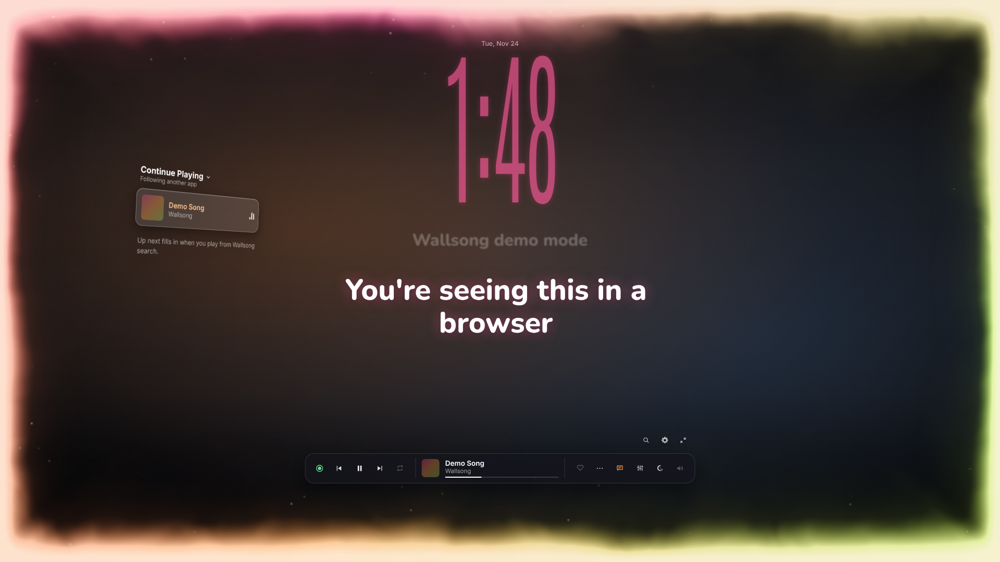

# Wallsong

Your desktop, on the beat. A music skin for Windows: the song's music video as your wallpaper, a tall clock, lyrics that build word by word, a flame of album colour around the screen that pulses with the bass, and controls spread across the desktop like a real app.

This is **v0.5.2: performance and efficiency update.** A massive overhaul across the desktop engine: zero per-frame style recalculations, coverage occlusion pausing when games or full-screen windows are open, timer-driven lyric synchronization, low-overhead WebGL rendering, memoized UI with direct DOM transforms, debounced settings, next-song preloading, and non-blocking Windows media session tracking.



## What's new in v0.5.2

| Area | What changed |
| --- | --- |
| Zero per-frame invalidations | Eliminated root-level CSS variable re-assignments; clock and edge-glow animations now update local refs with memoized string checks at optimal refresh rates (15–30 fps). Centralized rAF scheduler (`FrameScheduler`) pauses automatically when windows are occluded |
| Window coverage detection | Integrated native WinRT/Win32 monitor occlusion detection (`SHQueryUserNotificationState`, `WS_MAXIMIZE`, fullscreen). When a browser (e.g. Brave) or game covers the screen, beat loops, audio processing, and wallpaper frame loops pause completely, dropping CPU to ~0% |
| Frame-less lyric synchronization | Converted line/word tracking and Roll style from per-frame rAF polling to targeted timer scheduling with millisecond-exact word triggers and pause safety fallbacks |
| High-performance WebGL glow | Lowered offscreen render resolution scale to 0.35, noise octaves to 3, tightened raymarch bounds, and throttled shader fps to 30 fps (1 fps idle) with WebGL context recovery and resource cleanup |
| Inter-window messaging & external stores | Replaced cross-window broadcast cascades with fine-grained External Store selectors (`useWs`), memoized all dock tiles, player bars, and cards (`React.memo()`), and converted progress line rendering to direct DOM transforms (`scaleX` at 30 fps, time tooltip at 4 fps) without component re-renders |
| Hit regions on-demand | Replaced 5 Hz polling with `MutationObserver` + `ResizeObserver` + rAF debouncing, instantly catching overlay transitions with zero background CPU cost |
| CSS GPU blurs & shadows | Removed expensive backdrop filters and composited drop shadows from control layers, clamping shadow blur radii to max 24px and eliminating raster thrash |
| YouTube Music & Media session optimization | Cached WinRT SMTC media properties and throttled session listing to 5 seconds, avoiding synchronous COM stalls and eliminating all stutter during background YouTube Music or browser playback |
| Next-song preloading | Added background prefetching for lyrics, album art, and videos when playback passes 50% or 20s remaining, enabling instant song transitions |
| Settings write debouncing & native diffing | Debounced slider writes to 250 ms and diffed native setting changes so display and layout updates only execute when their specific properties change |
| Battery tile efficiency | Simplified charging state to a clean lightning bolt icon with green tint at 100% full, eliminating continuous pulse ring animations |
| Three new lyric styles | Modelled on reference lyric-wallpaper clips. **Tape**: each phrase builds a centred stack of mixed sizes (one huge hero word, medium words, small connectors) in vermilion, gold and cream; hero words sometimes sit on a tilted strip of tape, small words in a pill; the stack blurs out as the next one starts. **Cascade**: words pop in at the bottom of a staggered, slightly tilted column and push older ones up as they shrink and fade, with highlight boxes and emoji; repeated lines (the chorus) become tilted ALL-CAPS poster blocks with coral echo trails. **Slam**: one giant word fills the screen, each in its own colour with a matching glow behind it, entering with a punch, grow, streak or 3D letter tumble; some words get a highlight box or a swoosh underline. **Orbit**: 3D rotating globe & orb transitions modelled on spherical kinetic typography — phrases roll bottom-to-top across a curved spherical lens (`∩`/`∪` arches with subtle perimeter rim streaks), snap into counter-clockwise `-14° -> -86°` word Z-tumbles, and launch fast Y-axis spinning 3D shaded orb transitions with horizontal meridian blur ribbons, left Fresnel highlights, right shadow terminators, and trailing white rim arcs. All styles dim during instrumental breaks and honour reduced-motion settings |

## What came in v0.5.1

| Area | What changed |
| --- | --- |
| Desktop icons always come back | However Wallsong ends (Ctrl+C or closing the terminal, End task, a `tauri dev` rebuild, a crash, Quit), the icons are back within a second. A small **icon guard** (a second, hidden `wallsong.exe --icon-guard <pid>`) waits for Wallsong to end and shows them. Explorer starts it, so it isn't part of Wallsong's process tree, which End task and `cargo run` end all at once. Ctrl+C and closing the terminal also show them straight away. With "On the desktop", starting Wallsong shows icons an older build left hidden. Your own Explorer "Show desktop icons" choice is never overridden |
| Controls tile | A new Dock tile right after Now Playing, with every control of the v0.3 player bar in two rows: source, previous, play/pause (white circle), next, repeat, shuffle; like, more, lyrics on/off, lyrics timing, sleep timer, volume. Its menus are the bar's, opening upward from the tile; one click outside closes them. Added to your Dock automatically (once: remove it in Edit Dock and it stays removed) |
| Now Playing tile | Fixed: the art sat at the bottom and "Not playing" was cut off. The art is centred, text never spills out, and nothing playing shows "Not playing" with a Search button. The progress line is seekable (Wallsong's own songs). Click the art or the title to open the player card |
| Player card | Closed when Wallsong starts; if it was open last time, it comes back once a song is playing. Nothing playing: "Not playing" and a Search button instead of controls that can't do anything. Vinyl layouts: the album art label always shows (it could come out blank) |
| Battery | A bolt and a slowly pulsing ring while charging; a plug and a solid green ring when plugged in and full; green, amber or red on battery, blinking every 4 s below 10%. The tooltip says "Charging · 76%", "Plugged in · fully charged" or "On battery · 54% · about 2 h 10 min left". Updates every 10 s, and at once when you plug in or unplug |
| Settings > General | Tilt the song list and Desktop icons are back here (as in v0.4); Controls still has them too |

## What came in v0.5

| Area | What changed |
| --- | --- |
| The Dock | A glass bar of tiles centred along the bottom, 1.2vh above the taskbar wherever the taskbar is. Tiles lift on hover. The chevron on the left folds it down to just the song and back |
| Clock tile | Analog face with white hands and a second hand in the album colour. Right-click for a digital "10 45" flip clock (12- or 24-hour, from Settings > Clock) |
| Now Playing tile | Art, title (slides sideways now and then if it's too long), artist, times with a thin progress line, and shuffle, play/pause, previous, next. Click it to open the player card; right-click for the player menu. "Not playing" shows a search button |
| Weather tile | Your city, temperature, today's high and low and a drawn picture (sun, moon, cloud, rain, storm, snow, fog), from Open-Meteo (no account). Refreshes every 15 minutes. "Set your city" until you do (Settings > Dock) |
| Calendar, battery, Recycle Bin | Today's date (click: Windows Calendar). Battery ring, green, amber or red, with a bolt while charging; hidden on PCs without a battery. The bin fills when there's something in it; click to open it |
| Desktop tile and panel | A 3x3 peek at your desktop. Click it for a panel of everything on your Desktop and the Public Desktop, with their real Windows icons: search it, browse into folders (double-click opens one in File Explorer), open anything, right-click for Open, Show in folder, Pin to Dock, Copy path |
| Pins | Pin apps, folders and files to the Dock from the Desktop panel. Right-click a pin: Open, Show in folder, Unpin |
| Edit Dock | Right-click the Dock (or Settings > Dock): remove tiles with −, add them with +, drag to reorder, Done or Esc to finish. Saved across restarts |
| Desktop icons | Settings > Controls > Desktop icons: In the Dock (hidden from the desktop, shown in the Desktop panel) or On the desktop. Your v0.4 choice carries over. The tray item reads "Desktop icons: in the Dock / on the desktop" |
| Player card | Click the song: a card grows out of the tile. Eight layouts (Compact, Squared, Full Cover, Half Cover, Minimal, Vinyl, Minimal Art Color, Vinyl Art Color) that morph into each other. Drag it anywhere; it remembers where. A slight tilt until you hover it. Clicking elsewhere leaves it open; "Close player" closes it |
| Player menu | Right-click the card, its ··· button or the Now Playing tile: layouts, lyrics in the card, lyrics timing, sleep timer, play from, Edit…, Keep above all windows, Close player |
| Keep above all windows | The card moves into its own small window that stays on top of your apps (Brave and all). Turn it off and it goes back to the desktop at the same spot |
| Lyrics in the card | The line being sung shows under the title (Full Cover, Half Cover, Compact, Minimal) |
| Shuffle | A new shuffle button shuffles up next once (Wallsong's own songs) |
| Settings | New pages: Controls (Dock or player bar, desktop icons), Dock (city, °C/°F, clock style, Edit Dock, Reset Dock) and Player card (live previews of the 8 layouts, tilt, keep above, lyrics) |
| Player bar | Still there: Settings > Controls > Bottom of the screen > Player bar brings back the v0.3 bar. Its art opens the player card |

## What came in v0.4

| Area | What changed |
| --- | --- |
| Desktop icons | Hidden while Wallsong runs (Settings > General, or the tray's "Show/Hide desktop icons"; on by default). Only the icon list is hidden, never Explorer's own setting: quitting from the tray, or a crash, brings them back, and Explorer restores them after a restart. Wallsong re-hides them every 3 seconds if Explorer shows them again (F5) |
| Controls above icons | The control layer now sits directly above the window holding the icons instead of at the very bottom, so icons never draw over or block the song list and player bar, even with icons shown. Your apps still cover the controls |
| Click outside to close | Every menu (source, more, lyrics timing, sleep, volume, the song list picker, search suggestions) and every card (search, artist, album, settings) closes with one click anywhere outside it. That click doesn't fall through to the desktop. Esc still steps back, then closes |
| Roll lyrics | New style: one big word at a time in a warm album-colour gradient, the previous word small above it, the next word arriving below as a coloured block just before it's sung, then everything rolls up. Matching words get a little picture (Wallsong's own glyphs). Fast words skip the block; instrumental gaps dim the word. First in the style gallery |
| Compact clock | Settings > Clock > Layout: Tall (as before) or Compact, a small light clock with the date above. Picking Roll switches to Compact once; you can switch back |
| Chase glow | New glow style: a thin bright line hugging the screen edge with a warm haze, lit where 1 to 3 lights (Settings > Glow > Lights) travel around the frame. Brighter and a small jump forward on every kick |
| Album colours in the glow | Fixed: the glow ignored album colours (they arrive as `hsl(...)`, which the glow couldn't read) and showed pink for every song with artwork |
| Video | YouTube's captions ("[Music]") are switched off, and the video is cropped a little more (scale 1.2) so YouTube's edges, title and pill fall off the screen |
| Song list | Remembers whether you collapsed it |

## What came in v0.3

| Area | What changed |
| --- | --- |
| Glow | Drawn by the graphics card: a thick flame with a ragged moving edge, white-hot at the screen edge, sparks drifting off it. Thicker on kicks. Settings: Flame or Smooth, thickness, brightness, movement, sparks, your own two colours |
| Clock | Tall, narrow digits in the album colour (about 24% of the screen tall, 10% wide). 5 fonts including a serif, size, 12/24-hour, date on/off |
| Lyrics | The current line builds word by word as it's sung, each word blurring in. Two dim lines above it. 10 styles: Stack, Drop, Scrawl, Sweep, Tube, Lens, Stretch, Stars, Chat, Icons. 8 fonts, text size, your own colours |
| Controls layer | Controls now sit across the desktop: a thin player bar, a tilted song list on the left, cards in the middle. The mouse passes through to your icons everywhere else |
| Player bar | Source, previous, play, next, repeat, art and title with a thin progress line, like, more, lyrics on/off, lyrics timing, sleep timer, volume |
| Song list | Continue Playing (up next), Recently played, Liked songs; click to play |
| Search | Suggestions as you type, top results, artists, songs, albums in a cover flow, videos |
| Artist page | Photo, bio, Play and Shuffle, top songs, then albums, singles and videos |
| Album page | Cover, year, Play and Shuffle, track list |
| Video picker | Dots above the bar switch between the official video and other versions |
| Source menu | Wallsong only, Automatic, or follow one app (Brave, Spotify, anything Windows lists) |
| Now starting | A card in the middle when a new song starts |
| Settings | Lyrics (style gallery, font, size), Clock, Glow, Colours, Video, Displays, General |
| Displays | One wallpaper per screen: Everything, Video only, Lyrics and clock, or Off. Other screens mirror the main one, video muted and kept in step. Choose which screen gets the controls |
| Keep awake | The screen stays on while music plays (on by default) |

Not copied: Wallsong keeps its own logo, icons, fonts (all open-licence and bundled) and style names.

## Run it

```powershell
cd C:\Users\HomePC\Desktop\wallsong\wallsong-v0.3\wallsong
npm install
npm run tauri dev
```

Use a terminal opened after Rust was installed (it needs `cargo` on the PATH). The first run after this update recompiles the Rust side with new Windows features (a few minutes).

**Browser demo** (no Rust needed): `npm run dev`, then open http://localhost:1420 (the wallpaper) and http://localhost:1420/?view=overlay (the controls) in two tabs. Search and pages show fixed demo results; the desktop, battery, weather and Recycle Bin tiles need the app.

## Gate P: v0.5.2 Performance & Efficiency tests on your PC

These can only be proven on real Windows with release builds. Do them in order and tell me which fail.

- [ ] **P1. Total CPU under 8% during active playback.** Measure Task Manager with wallpaper and audio active: combined wallsong.exe, WebView2, and GPU process CPU stays < 8% (idle < 2%).
- [ ] **P2. Occlusion CPU < 1%.** Maximize Brave, Chrome, or any full window: wallpaper and audio loops pause within 1 second, dropping CPU consumption to under 1%.
- [ ] **P3. YouTube Music playback without lag.** Play songs in YouTube Music; Wallsong tracks smoothly with zero stutter or browser freezing.
- [ ] **P4. Smooth click responsiveness (< 100 ms).** Opening the player card, Settings, or Dock menus responds instantly without dropped frames or visual lag.
- [ ] **P5. Next song starts in < 1.5 seconds.** Advancing or jumping to the next queued song starts playback and lyrics immediately using preloaded assets.
- [ ] **P6. Memory steady over extended playback (< 80 MB growth over 30 min).** Memory consumption remains flat without leaks in WebGL, frame subscriptions, or WinRT handles.
- [ ] **P7. Feature preservation.** Every user-facing feature (Dock tiles, layouts, Roll lyrics, glow, clock, playlists, settings) remains intact and functional.
- [ ] **P8. New lyric styles.** Settings > Lyrics shows Orbit, Tape, Cascade and Slam right after Roll. Orbit: phrases scroll vertically through a 3D curved sphere lens (`∩` above, `∪` below), words pop at `-14°` and tumble counter-clockwise to `-86°` sideways, and transitions spin a 3D shaded orb around Y with blurred meridian bands, a left crescent rim highlight, and a trailing white arc. Tape: words stack in mixed sizes, some hero words on tilted tape, the stack blurs away for the next phrase. Cascade: words rise in a staggered column, and a chorus line turns into a tilted ALL-CAPS poster with echo trails. Slam: one giant word at a time, a new colour and glow each word, never cut off at the screen edge.

## Gate E: v0.5.1 tests on your PC

These can only be proven on real Windows. Do them in order and tell me which fail.

- [ ] **E1. Icons come back.** Start with `npm run tauri dev` (Dock mode, desktop icons "In the Dock", so they're hidden). Stop it each of these ways; each time the icons are back within 2 seconds: Ctrl+C in the terminal; closing the terminal window; saving a `.rs` file so dev rebuilds; End task in Task Manager; Quit from the tray.
- [ ] **E2. Nothing missing.** Every feature in the v0.5.1 audit (wallpaper, player controls, overlay, settings, native) works in Dock mode, reachable on screen without opening a menu.
- [ ] **E3. Controls tile.** Each button works (source, previous, play/pause, next, repeat, shuffle, like, more, lyrics, lyrics timing, sleep, volume). Each menu opens upward from the tile and closes with one click outside (or its own button).
- [ ] **E4. Now Playing tile.** Idle: gradient art, "Not playing" and Search, all centred, nothing cut off. Playing: art, title, artist, times; clicking the line seeks; clicking the art or title opens the card.
- [ ] **E5. Battery.** Plug in: the bolt and a pulsing ring appear within 2 seconds. Full on the charger: the plug and a solid green ring. Unplugged: green, amber or red, and the tooltip shows the time left.
- [ ] **E6. Player bar.** Settings > Controls > Bottom of the screen > Player bar: the bar has everything it had in v0.3 (source, previous, play, next, repeat, art and title with the progress line, like, more, lyrics, lyrics timing, sleep, volume).

## Gate D: v0.5 tests

These can only be proven on real Windows. Do them in order and tell me which fail.

- [ ] **D1. Desktop in the Dock.** Desktop icons are gone from the desktop, and the Desktop tile shows all of them (including Public Desktop items) with their real icons. Clicking a shortcut opens the app; clicking a folder browses into it; double-click opens it in File Explorer.
- [ ] **D2. Pins and Edit Dock.** Right-click, then Pin to Dock, puts an item in the Dock. Unpin removes it. Edit mode removes, adds and reorders tiles, and the result survives a restart.
- [ ] **D3. Folding.** The chevron folds the Dock to just the song and unfolds it again.
- [ ] **D4. Player card.** Clicking the song opens the floating card. All 8 layouts switch with a smooth morph. Compact matches the reference: art, title, waveform, times, control row.
- [ ] **D5. Drag and keep above.** The card drags and remembers its position. "Keep above all windows" keeps it on top of Brave, and turning it off puts it back on the desktop.
- [ ] **D6. Tiles.** Weather shows your city after you set it. Battery shows only on a laptop. The calendar date is right. The Recycle Bin opens and shows its fill state.
- [ ] **D7. Click outside.** Every menu and panel still closes with one click outside. The desktop is clickable again straight after.
- [ ] **D8. Going back.** "Bottom of the screen: Player bar" brings back the v0.3 bar exactly, and "Desktop icons: On the desktop" brings the icons back.

## Gate C: v0.4 tests

These can only be proven on real Windows. Do them in order and tell me which fail.

- [ ] **C1. Icons hidden.** Desktop icons are hidden while Wallsong runs. Quitting from the tray brings them back. Turning it off and on in Settings > General, and with the tray's "Show/Hide desktop icons", works.
- [ ] **C2. Controls above icons.** With icons shown (C1 off), the song list and player bar are never covered by icons, and clicking the Continue Playing card works. Your apps (Brave, etc.) still cover the controls.
- [ ] **C3. Click outside to close.** Open each of: source, more, lyrics timing, sleep, volume, the song list picker, search, an artist page, settings. Each closes with one click anywhere on the wallpaper. After closing, double-clicking a desktop icon (with icons shown) works on the first try.
- [ ] **C4. Roll.** Settings > Lyrics > Roll: one big word at a time, the previous word small above, the next word appears as a coloured block below just before it's sung, then rolls up. Pictures pop next to matching words (you, love, night, money...).
- [ ] **C5. Compact clock.** After picking Roll the clock is small and light above the lyrics. Settings > Clock > Layout > Tall brings the tall clock back, and it still works.
- [ ] **C6. Chase.** Settings > Glow > Chase: bright stretches travel around the screen edge while the rest stays dim; it brightens and jumps on kicks. Lights 1 to 3 changes how many travel.
- [ ] **C7. Clean video.** No "[Music]" captions and no YouTube pill on the video wallpaper.
- [ ] **C8. GPU.** With Chase on, Task Manager shows Wallsong's GPU use under about 15%.

## Gate B: v0.3 tests

Still worth a pass after an update. Do them in order and tell me which fail.

- [ ] **B1. Clicks pass through.** With nothing playing, double-click a desktop icon in an empty area of the screen (not under the bar or the list). It opens. Then click the player bar's buttons: they work.
- [ ] **B2. The controls stay on the desktop.** Open Brave: it covers the controls. Press Win+D: the desktop shows and the controls are still there.
- [ ] **B3. The taskbar stays.** With Wallsong running, the taskbar is visible and notifications still pop up.
- [ ] **B4. Search to video.** Ctrl+Alt+Space, type `get lucky`, click the first song. The card closes, a "Starting on YouTube Music" card shows, and the music video plays behind your icons with sound. If a toast says Error 153, screenshot it.
- [ ] **B5. Pages.** Search an artist and click them: the artist page opens with photo, bio and top songs. Click an album in the cover flow: the track list opens. (Built from YouTube Music's known page layout; your PC is the first real test.)
- [ ] **B6. Video dots.** While a song plays, the dots above the bar switch to other videos of the same song.
- [ ] **B7. Glow.** The flame moves, gets thicker on kicks, and Task Manager shows Wallsong under about 15% GPU.
- [ ] **B8. Second screen** (if you have one). Settings > Displays: set it to Everything. The same video and lyrics show there, silent, in step.

Plus from earlier gates: lyrics within about 0.3 s (use the timing button on the bar), Spotify in Brave still followed.

## Things you should know

| Behaviour | Why, and what to do |
| --- | --- |
| Lyric words may lead or lag a little | LRCLIB gives a time per line only; Wallsong spreads the words by syllables. Line timing is exact; word timing is an estimate |
| Panels look solid rather than see-through | Windows can't blur one window through another, so cards are nearly solid to stay readable over the lyrics |
| Ads may play before some videos | They come from YouTube inside the embedded player; Brave's blocker can't reach Wallsong |
| Some videos won't play inside Wallsong | The label blocked embedding; Wallsong switches to the song's audio and says so |
| Search or pages suddenly stop working | Wallsong uses YouTube Music's unofficial web API, which can change. Send me the toast |
| Icons under the bar or the list | Those spots belong to Wallsong's controls. Collapse the list with the button above the bar, or move icons |
| Desktop icons stayed hidden after a crash | The icon guard should bring them back within a second. If it didn't (Explorer itself wasn't running, say): Task Manager, right-click Windows Explorer, Restart |
| A second `wallsong.exe` in Task Manager | That's the icon guard (`--icon-guard`). It uses no CPU, waits for Wallsong to end, shows the desktop icons and exits. It appears under Windows Explorer, not under Wallsong, on purpose |
| The Controls tile isn't in my Dock | It's added once to older Docks. If you removed it, add it back: right-click the Dock, Edit Dock, + |
| The battery's bolt shows while plugged in at 80% | Wallsong counts "on the charger and below 100%" as charging, even when the laptop holds the battery at 80% to protect it |
| Icons missing everywhere | Settings > Controls > Desktop icons > On the desktop, or restart Windows Explorer from Task Manager. |
| Desktop icons stay on the desktop with the player bar | "In the Dock" only hides them while there's a Dock to hold them. Switch Bottom of the screen back to Dock |
| The weather tile says "--" | Open-Meteo couldn't be reached; it tries again every 15 minutes |
| The Calendar tile does nothing | Windows Calendar isn't installed; the tile only opens that app |
| A click right after opening a menu does nothing on the desktop | While any menu or card is open, the first click outside it only closes it (like menus in any app). Click again |

## Layout

```
src/
  main.tsx                picks the window: wallpaper, mirror, overlay or mini (the always-on-top card)
  wallpaper/              Wallpaper.tsx (scene + mirrors, lyric line broadcast), controller.ts (player brain), ytPlayer.ts
  overlay/                Overlay.tsx (layer, hit regions, menus), Dock.tsx + dock.css, tiles/ (one file per tile,
                          ControlsTile: every player button),
                          DesktopPanel.tsx, PlayerCard.tsx + playerCard.css (8 layouts, mini window page),
                          PlayerBar (v0.3 bar and the icon row), popovers, menus, Library (song list, now starting),
                          Browse (search, artist, album, cover flow), SettingsPanel, icons
  lyrics/                 LyricsStage.tsx (11 styles), lyrics.css, wordIcons.ts (Roll pictures)
  components/             Clock, GlowCanvas (GPU glow), EdgeGlow (fallback), Backdrop
  lib/                    settings, word timing, fonts, types, bus, palette, LRC parser
src-tauri/src/
  main.rs                 starts the app, or (with --icon-guard <pid>) waits for it to end and shows the desktop icons
  lib.rs                  windows, screens, click-through, keep awake, icon keeper and guard, Ctrl+C handler,
                          tray, hotkey, commands
  settings.rs             settings file shared by every window (and moving old settings forward)
  shelf.rs                the Dock's Windows side: desktop items and their icons, open/reveal, battery
                          (and its 10 s / plug-in watcher), Recycle Bin, work area
  weather.rs              Open-Meteo weather and city search
  ytmusic.rs              search, suggestions, up next, videos, artist and album pages
  media.rs                follows other apps; the source menu's list of apps
  desktop.rs              behind-the-icons and above-the-icons layering, hiding the desktop icons,
                          starting a program through Explorer (the icon guard)
  audio.rs, lyrics.rs, meta.rs
```

## Tests

- YouTube Music parsing: `cd src-tauri && cargo test --lib ytmusic`
- Settings merging, moving old settings forward (v0.4 icon switch, adding the Controls tile once) and title cleaning: `cargo test --lib settings` and `cargo test --lib meta`
- Weather codes to pictures and Open-Meteo answers: `cargo test --lib weather`
- Desktop listing (sort order, hidden and system files, shortcut names, icon cropping) and the battery (charging, full, on battery, unknown time): `cargo test --lib shelf`
- Starting a program through Explorer (touches your desktop, so run by hand): `cargo test --lib explorer -- --ignored`
- Compiles for Windows and the pages type-check: checked before delivery.
